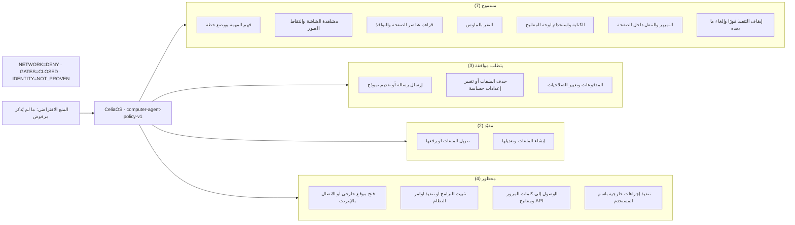

# صلاحيات وكيل الكمبيوتر في CeliaOS

> **مُولَّد آليًا** من `src/agent/computer-policy.js` (`computer-agent-policy-v1`). لا تُحرّره يدويًا:
> `npm run computer:permissions` يعيد توليده، و`npm run computer:permissions:check` يُفشل CI عند الانحراف.
>
> **لا شيء هنا مُنفَّذ:** 0 من 16 قدرة موصولة بمحرك تنفيذ. `AGENT-003` (العزل) موقوفة،
> لذا `decideAction` يعيد الحكم السياسي مع `executable: false`. المخطط يوثّق الحدود، ولا يثبت أن النقر والكتابة يعملان.

**حالة النظام المعلنة:** `NETWORK = DENY` · `EXTERNAL GATES = CLOSED` · `IDENTITY = NOT_PROVEN`

## المصفوفة

| المعرف | القدرة | الحالة | الحد | البوابة | موصولة |
|---|---|---|---|---|---|
| `plan_task` | فهم المهمة ووضع خطة | مسموح | عقد المهمة المعتمد | Goal contract | لا |
| `capture_screen` | مشاهدة الشاشة والتقاط الصور | مسموح | الجلسة المصرح بها فقط | Session scope | لا |
| `read_elements` | قراءة عناصر الصفحة والنوافذ | مسموح | نطاق المهمة الحالية | Task scope | لا |
| `click` | النقر بالماوس | مسموح | عناصر مرتبطة بالخطة المعتمدة | Plan-linked target | لا |
| `type_text` | الكتابة واستخدام لوحة المفاتيح | مسموح | حقول وتطبيقات مصرح بها | Field allowlist | لا |
| `scroll` | التمرير والتنقل داخل الصفحة | مسموح | النطاق المسموح | Task scope | لا |
| `open_url` | فتح موقع خارجي أو الاتصال بالإنترنت | محظور | بوابة الشبكة مغلقة | NETWORK = DENY | لا |
| `submit_form` | إرسال رسالة أو تقديم نموذج | يتطلب موافقة | موافقة بشرية قبل الإرسال | Approval gate | لا |
| `transfer_file` | تنزيل الملفات أو رفعها | مقيّد | إذن صريح + تحقق من المصدر والوجهة | Source/destination check | لا |
| `edit_file` | إنشاء الملفات وتعديلها | مقيّد | مسارات مسموح بها + استرجاع | Path allowlist + rollback | لا |
| `delete_file` | حذف الملفات أو تغيير إعدادات حساسة | يتطلب موافقة | موافقة حسب خطورة التغيير | Risk-scaled approval | لا |
| `run_system_command` | تثبيت البرامج أو تنفيذ أوامر النظام | محظور | لا صلاحيات مسؤول نظام | Admin boundary | لا |
| `read_secrets` | الوصول إلى كلمات المرور ومفاتيح API | محظور | الأسرار لا تُعرض ولا تُسجَّل | Secret boundary | لا |
| `payment_or_privilege` | المدفوعات وتغيير الصلاحيات | يتطلب موافقة | موافقة بشرية إلزامية، لا تنفيذ تلقائي | Human-in-the-loop | لا |
| `act_as_user` | تنفيذ إجراءات خارجية باسم المستخدم | محظور | حتى إثبات الهوية وفتح البوابات | IDENTITY = NOT_PROVEN | لا |
| `stop_execution` | إيقاف التنفيذ فورًا وإلغاء ما بعده | مسموح | متاح دائمًا للمشغّل | Operator kill switch | لا |

## مخطط

## قواعد إلزامية

- المنع الافتراضي: أي صلاحية غير محددة بوضوح تُرفض
- أقل صلاحية: لا يحصل الوكيل إلا على ما تحتاجه المهمة الحالية
- النية ليست نتيجة: النقر لا يعني نجاح العملية، والتحقق مستقل
- الإيقاف عند الغموض: إذا تغيرت الصفحة أو الهدف، يتوقف الوكيل ويعيد التقييم
- سجل قابل للمراجعة: الإجراء والسبب والقرار والنتيجة، بلا كلمات مرور أو أسرار
- إيقاف فوري: للمشغّل أن يوقف التنفيذ ويلغي الإجراءات اللاحقة

## الميزة التنافسية: الاستقلالية المصحوبة بأدلة (Evidence-Carrying Autonomy)

لا يكفي أن يعلن الوكيل نجاحه؛ عليه أن يقدّم دليلًا يُتحقق منه مستقلًا عنه — وهذا ما لا تمنحه سهولة النقر والكتابة وحدها.

- **حوكمة قبل التنفيذ:** كل إجراء يمر بمحرك السياسة؛ الأداة لا تتجاوز الصلاحية حتى لو طلب النموذج ذلك.
- **دليل لكل خطوة:** الهدف، قرار السياسة، نتيجة الأداة، والدليل الداعم — مسجّلة ومترابطة.
- **ناقد ومتحقق مستقلان:** يفحصان الناتج الفعلي ويكشفان النجاح الكاذب بدل تصديق تقرير الوكيل عن نفسه.
- **استعادة قابلة للتدقيق:** سجل متين يعيد بناء الحالة؛ وإعادة التشغيل لا تكرر الأثر الخارجي تلقائيًا.
- **اختبار موضوعي مستمر:** مهام ثابتة تقيس الصحة والالتزام بالصلاحيات والتعافي والتكلفة.

### المراحل

| # | المرحلة | ما نبنيه | معيار النجاح |
|---|---|---|---|
| 1 | تثبيت الحوكمة | Capability Registry + Policy Engine + بوابات الموافقة | صفر إجراءات غير مصرح بها في الاختبارات |
| 2 | إثبات التنفيذ | Evidence Ledger + متحقق مستقل + استعادة آمنة | لا نجاح دون دليل كافٍ |
| 3 | تعميم الاختبارات | مهام متعددة وأخطاء متعمدة وإعادة محاولة | قياس النجاح الكاذب والفشل الكاذب وإعادة البناء |
| 4 | المقارنة العادلة | تشغيل المهام نفسها على CeliaOS وClaude وManus | نتائج قابلة للتكرار: دقة وتكلفة وزمن وأمان |

> هذه ميزة مستهدفة، وليست إثبات تفوّق حالي: لا مقارنة مهام موحّدة أُجريت بعد، ولا محرك تنفيذ كمبيوتر موصول في هذا المستودع.
