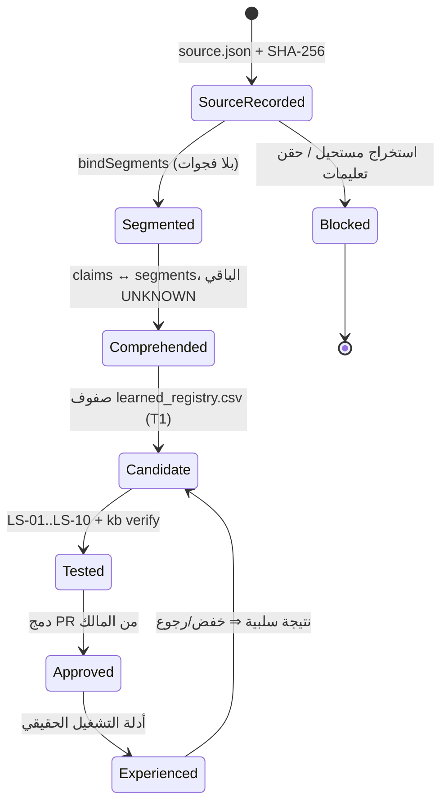

# بروتوكول التعلم المحكوم — CELIA-LEARN-001

> كيف تتعلم CeliaOS من مصدر خارجي (فيديو، مقال، محاضرة) دون أن تدّعي ما لم تثبته، ودون أن تنسخ ما لا تملكه، ودون أن
> تلمس أي نموذج. التعلم هنا يعني: **سجل مصدر ببصمة، فهم مربوط بمقاطع، وحدات معرفة بصياغتنا داخل شبكة المعرفة، اختبارات،
> ثم موافقة المالك**. لا تُدرَّب أوزان، ولا تُفعَّل أدوات، ولا تُفتح بوابات خارجية.

**المبادئ الأربعة:** كل حقيقة لها مصدر · كل إجراء له شروط · كل قدرة لها اختبارات · كل تغيير له سجل ورجوع.
**الأقفال:** `NETWORK = DENY` داخل النظام (الاستخراج يتم خارج وقت التشغيل عبر أدوات الجلسة أو بنسخ المالك) ·
`EXTERNAL GATES = CLOSED` · لا ادعاء بأن «النموذج تعلّم».

## 1) المراحل والمخرجات

| المرحلة | ما يحدث | المخرج الملتزم به | الملف/المكوّن |
|---|---|---|---|
| 0 حماية النظام | التأكد أن الفرع نشط، وأن التغيير لا يمس `tool-policy.js` ولا الأدوات ولا الأسرار | — | `AGENTS.md`، `check:secrets` |
| 1 هوية المصدر | عنوان، قناة، تاريخ، مدة، رابط قانوني، قناة الاستخراج ومحاولاتها، **SHA-256** للنص المستخرج | `data/learning/sources/<id>/source.json` | `scripts/learn-source.mjs` |
| 2 بوابة الفهم | تقسيم النص إلى مقاطع متصلة بلا فجوات (بصمة لكل مقطع)؛ أي موضوع لم يُستخرج نصه = `UNKNOWN` | `segments[]`، `topics_unknown[]`، `claims[]` | `bindSegments()` |
| 3 التحويل | وحدات **معرفة** (ملاحظات بصياغتنا + «ما يهمنا») أو **إجراءات** (بشروط) أو **قدرات مرشحة** (باختبارات) | `data/kb/learned_registry.csv` | `validate.js` |
| 4 الربط | شبكة المعرفة (`sources_registry.csv` بنوع `video` وترخيص `reference-only`)، الذاكرة الحلقية (`agent_runs/evidence` عند التشغيل)، سجل القدرات (لا تغيير) | manifest ببصمات | `kb:manifest`، `kb -- verify` |
| 5 بطارية الاختبار | 10 فحوص حتمية بلا شبكة ولا نموذج (أدناه) | `test/learning-protocol.test.js` | `npm test` |
| 6 الموافقة | **بوابة الموافقة = مراجعة ودمج PR من المالك**؛ قبل الدمج تبقى الوحدات `CANDIDATE` بثقة `T1` | `approval.stage` | GitHub PR |
| 7 التعلم من التنفيذ | لاحقًا: نتائج التشغيل الحقيقي تُسجَّل كأدلة محكومة ترفع أو تخفض الثقة؛ الرجوع `git revert` + `kb import --apply` | — | `src/agent/*` |

### قواعد لا تُكسر

- **النص الأصلي لا يُلتزم به في Git** (`.gitignore`: `data/learning/sources/*/transcript*.txt`). ما يُلتزم به: `source.json`
  ببصمات النص والمقاطع، وملاحظات بصياغتنا في CSV بترخيص `internal-owner` تشير إلى المصدر عبر `source_url`.
- **`reference-only` ترخيص لصفوف `sources` فقط** (مصدر خارجي بحقوق محفوظة يُربط ولا يُنسخ). صف معرفة يحمله يُرفض
  (`license_not_allowed`).
- **لا وحدة بلا ادعاء مدعوم بمقطع** ولا ادعاء بلا وحدة؛ عدد الصفوف الموسومة `learn:<id>` يساوي عدد الادعاءات `supported`.
- **الاستخراج الجزئي لا يصبح فهمًا كاملًا:** `EXTRACTION = PARTIAL` يمنع `COMPREHENSION = VERIFIED`.
- **الثقة تبدأ من `T1`** (الأدنى، وزن 0.4 في الترتيب). رفعها قرار مالك بعد مقابلة مصدر مستقل، ويظهر أثره في البحث
  (`minTrust=T2` يخفي الملاحظات أحادية المصدر).
- **المحاضرة لا تنتج أداة ولا قدرة مفعّلة.** أي قدرة مرشحة تمر عبر `tool-policy.js` (الكود هو السلطة) باختباراتها.
- **فحص حقن التعليمات** على نص الطرف الثالث حتمي (`scanInjection`)، وأي نتيجة تُبقي المصدر محجوبًا حتى مراجعة المالك.

## 2) متجه الحالة

`SOURCE ∈ {VERIFIED, UNKNOWN, BLOCKED}` · `EXTRACTION ∈ {FULL, PARTIAL, BLOCKED}` · `COMPREHENSION ∈ {VERIFIED, PARTIAL, UNKNOWN}` ·
`KNOWLEDGE / PROCEDURE / CAPABILITY ∈ {NONE, CANDIDATE, APPROVED}` · `REGRESSION ∈ {PASS, FAIL, NOT_RUN}`.

## 3) دورة الحياة



## 4) بطارية الاختبار (LS-01..LS-10)

| # | الفئة | ما يثبته | الحكم |
|---|---|---|---|
| LS-01 | عقد | كل سجل مصدر يحمل الهوية والبصمات ومتجه حالة كاملًا؛ الجزئي لا يُعلن فهمًا كاملًا | PASS |
| LS-02 | فهم | كل ادعاء مدعوم يشير إلى مقاطع موجودة وإلى صف واحد يحمل رابط المصدر والوسم والمقاطع | PASS |
| LS-03 | فهم | المواضيع المعلنة في وصف المصدر دون نص مستخرج تبقى UNKNOWN ولا تُكتب لها صفوف (AGI/ASI/NLP/CV) | PASS |
| LS-04 | تطبيق | نوع المصدر `video` مقبول؛ `reference-only` صالح للمصادر فقط ومرفوض للمعرفة؛ نوع مجهول يُرفض | PASS |
| LS-05 | أمان | النص الأصلي غير متتبع في Git | PASS |
| LS-06 | فهم | البصمات المسجلة تطابق النص المحلي عند وجوده (وإلا يُتخطى الفحص صراحة لا يُزيَّف) | PASS |
| LS-07 | أمان | فحص حقن التعليمات نظيف؛ لا قدرات؛ لا تعليمات قابلة للجلب في الملاحظات؛ الماسح يلتقط نصًا عدائيًا | PASS |
| LS-08 | استرجاع | البحث العادي يعيد الوحدة أولًا بسؤالها، وبالاسم الإنجليزي، مع المصدر و`T1`؛ `minTrust=T2` يخفيها | PASS |
| LS-09 | عقد | ربط المقاطع صارم: فجوة/تداخل/ذيل غير مغطى ⇒ رفض | PASS |
| LS-10 | تطبيق | لا صف تعلم بلا سجل مصدر ملتزم به؛ كل صف `T1` | PASS |

## 5) التشغيلة الأولى — `yt-Cb3mBAH0IaY`

- **المصدر (VERIFIED):** «شرح جميع أنواع الذكاء الاصطناعي في 25 دقيقة | الدليل الكامل من Machine Learning إلى AGI وASI» —
  قناة «خلف القصة»، رُفع 2026-08-04، المدة 25:04، <https://www.youtube.com/watch?v=Cb3mBAH0IaY>.
- **الاستخراج (PARTIAL):** قارئ صفحات مستضاف أعاد البيانات الوصفية ونص التسميات **بلا طوابع زمنية** حتى منتصف مقطع
  التعلم العميق (6395 حرفًا، 180 سطرًا، 12 مقطعًا؛ SHA-256 في `source.json`). محاولات `timedtext`/Invidious/Piped فشلت
  (500/حاجز بشري)، وشبكة الصندوق الرملي تمنع `youtube.com`. **لإكماله:** الصق نص «إظهار النص» كاملًا بصيغة `mm:ss نص`
  أو ارفع `.srt`؛ عندها يُعاد الربط بطوابع زمنية ويُحدَّث `source_url` إلى `#t=<ثانية>`.
- **الفهم (PARTIAL):** 9 ادعاءات مدعومة بمقاطع S01–S12؛ موضوعات NLP والرؤية الحاسوبية والروبوتات وAGI وASI والتطبيقات
  والوظائف **UNKNOWN** (أعلنها الوصف فقط) ولم تُكتب لها وحدات.
- **الوحدات:** 9 وحدات معرفة `CANDIDATE` بثقة `T1` في `data/kb/learned_registry.csv` (وسم `learn:yt-Cb3mBAH0IaY`)،
  صفر إجراءات، صفر قدرات. `kb -- verify`: 9 مضافة، 0 مرفوضة، 71 حافة بلا تعليق.
- **ما يهمنا منها (الخلاصة التطبيقية):**
  1. طبقات CeliaOS الحتمية (المُتحقِّق، سياسة الأدوات، بوابات KB) هي «ذكاء ضيق قائم على القواعد» بالتصميم: متوقعة لكنها
     تتوقف أمام الجديد؛ لذا الجديد يُحال `UNKNOWN`/موافقة المالك لا تخمينًا.
  2. «البيانات أهم من الخوارزمية»: بوابات المصدر والترخيص والثقة والقِدَم تسبق أي تعلم؛ مصدر رديء يصنع مساعدًا رديئًا.
  3. التعلم بالتعزيز = تعلم من مكافآت وعقوبات؛ مقابله عندنا (المرحلة 7) تغذية راجعة محكومة تُسجَّل كأدلة — دون تعديل
     أوزان أي نموذج.
  4. التعلم العميق يحتاج بيانات وحوسبة ضخمة؛ طبقة النموذج خارجية عبر Model Router ولا تُدرَّب داخل النظام.
- **الانحدار (PASS):** `LS-01..LS-10` 10/10 و`npm test` 295/295 (اختبار خط الأساس N/N−1 يحتاج تاريخ Git كاملًا).
- **متجه الحالة:** `SOURCE=VERIFIED · EXTRACTION=PARTIAL · COMPREHENSION=PARTIAL · KNOWLEDGE=CANDIDATE(9) · PROCEDURE=NONE · CAPABILITY=NONE · REGRESSION=PASS`.

## 6) الأوامر

```bash
node scripts/learn-source.mjs data/learning/sources/<id>            # يكتب بصمات النص والمقاطع في source.json
node scripts/learn-source.mjs data/learning/sources/<id> --check    # يتحقق فقط (exit 1 عند الانحراف)
npm run kb:manifest && npm run kb -- verify                         # عقد السجلات + الرسم البياني
node --test test/learning-protocol.test.js                          # البطارية LS-01..LS-10
```

## 7) الحدود المعلنة

- لا فهم دلالي بنموذج بعد (AI-002)؛ بوابة الفهم هنا حتمية: ادعاء ↔ مقطع ↔ بصمة.
- الطوابع الزمنية تعتمد على قناة الاستخراج؛ بدونها يبقى `source_url` على مستوى الفيديو لا الثانية.
- الحقائق أحادية المصدر (مثل «دارتموث 1956») تبقى `T1` حتى تُقابَل بمصدر مستقل يقرّه المالك.
